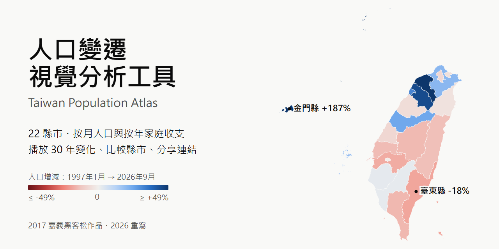
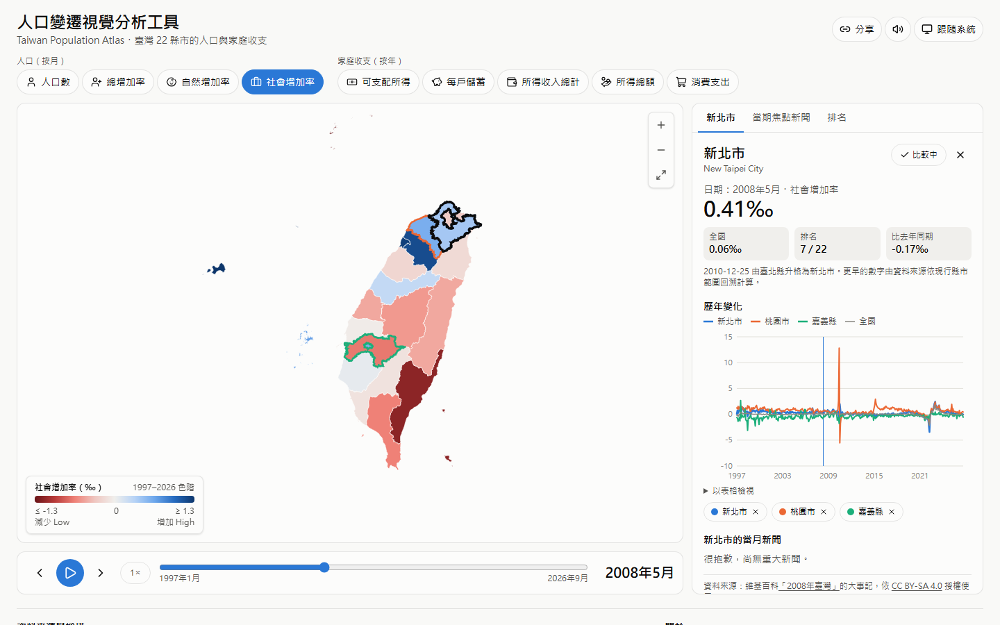
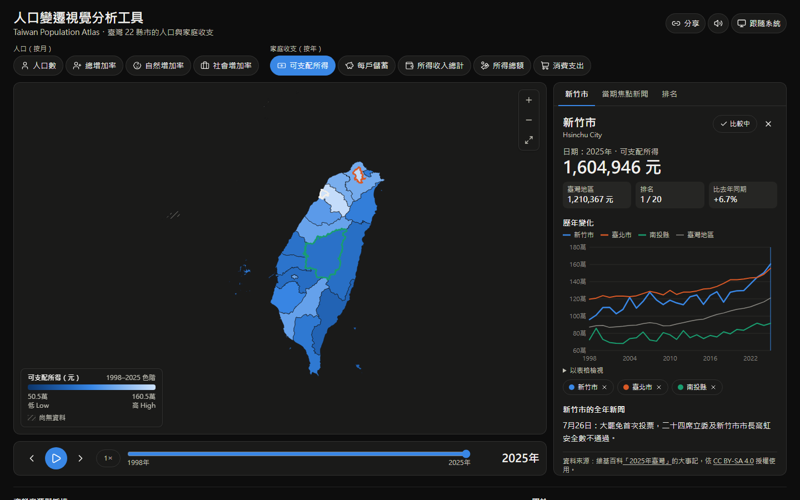
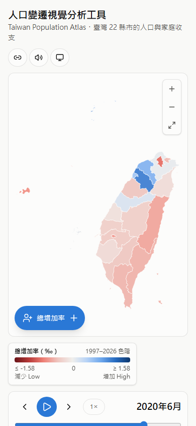
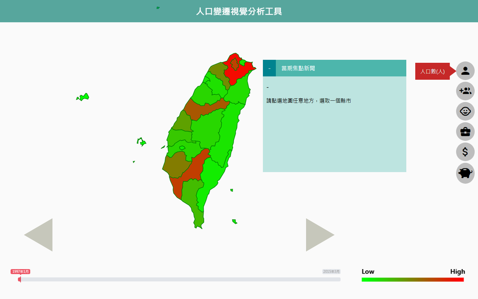
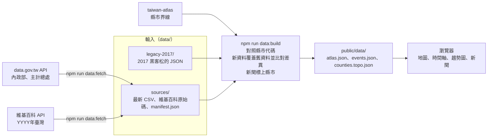

> [!NOTE]
> 這是 **2017 年嘉義黑客松**（Chiayi Hackathon）的作品「人口變遷視覺分析工具」，**2026 年用 React、TypeScript 和 D3 重寫**。
> 原本的 jQuery 版本留在 git 歷史裡（commit `15ea329`），想看當年的樣子可以 checkout 回去。

# 人口變遷視覺分析工具 · Taiwan Population Atlas



[](https://github.com/NatLee/taiwan-population-atlas/actions/workflows/ci.yml)
[](https://github.com/NatLee/taiwan-population-atlas/actions/workflows/pages.yml)
[](LICENSE)
[](https://data.gov.tw/license)

在地圖上看臺灣 22 個縣市的人口怎麼變：哪裡在長、哪裡在縮，是因為出生死亡還是搬來搬去，再對照各地的家庭所得和儲蓄。拉時間軸或按播放，30 年的變化會在地圖上動起來；點一個縣市可以看它的歷年走勢和當月新聞，也可以拉幾個縣市放在一起比較。資料來自政府開放資料平台和維基百科，附有可以重跑的轉換腳本。

**線上版**：<https://natlee.github.io/taiwan-population-atlas/>

## 功能

- **九種指標**：人口數、總增加率、自然增加率、社會增加率（內政部，按月，1997-01 起），以及可支配所得、每戶儲蓄、所得收入總計、所得總額、消費支出（主計總處家庭收支調查，按年，1998 起）。
- **時間軸**：拖拉滑桿、按上一期／下一期（到頭會繞回另一端），或按 ▶ 自動播放，可切換 1×、2×、4× 速度。切換按月和按年的指標時，時間會自動換算。
- **地圖**：滑過縣市看數值，點縣市看詳細資料，點海面取消選取。可以縮放（1～10 倍）和拖曳。
- **縣市資訊**：當期數值、全國數值、排名、比去年同期，以及歷年趨勢圖（點圖表可以跳到那個時間）。
- **比較縣市**：最多 4 個縣市畫在同一張趨勢圖，每個縣市固定一個顏色，地圖上也會用同色框起來。
- **當期焦點新聞**：選中縣市的當月新聞，以及沒指名縣市的全國新聞，整理自維基百科「YYYY年臺灣」條目。
- **排名表**：所有縣市依當期數值排序，也是地圖的表格版，可以用鍵盤操作。
- **色盲友善配色**：人數和金額用單一藍色漸層，增加率用藍（增加）對紅（減少）並以灰色當 0。原本的綠到紅漸層紅綠色盲看不出差別，已經換掉。
- **深色模式**：跟隨系統，也可以手動切換。
- **可以分享的網址**：指標、時間、選中和比較中的縣市都會寫進網址，例如 [`?metric=socialIncreaseRate&period=2008-05&county=65000`](https://natlee.github.io/taiwan-population-atlas/?metric=socialIncreaseRate&period=2008-05&county=65000)。
- **手機版**：指標選單收成一顆按鈕，展開時畫面變暗、選項依序出現，還保留 2017 年版本的音效（頁首的喇叭按鈕可以關掉）。

## 截圖

| 淺色 | 深色 |
|---|---|
|  |  |



<details>
<summary>2017 年黑客松版本的樣子</summary>



</details>

## 快速上手

需要 Node.js 22.12 以上（CI 用 Node 24）。

```bash
git clone https://github.com/NatLee/taiwan-population-atlas.git
cd taiwan-population-atlas
npm ci
npm run dev        # 開發伺服器，預設 http://localhost:5173/
```

其他指令：

| 指令 | 做什麼 |
|---|---|
| `npm test` | 跑 Vitest 測試（資料轉換、縣市對照、元件、整個 App） |
| `npm run lint`、`npm run typecheck` | ESLint 和 TypeScript 檢查 |
| `npm run build` | 打包到 `dist/`；設定 `BASE_PATH=/repo-name` 可以部署到子路徑 |
| `npm run data:build` | 用 `data/` 裡的輸入重新產生 `public/data/` |
| `npm run data:update` | 先下載最新資料（`data:fetch`），再重新產生（`data:build`） |
| `npm run cover` | 用最新資料重畫 `docs/images/cover.html`，再用瀏覽器存成 PNG |

## 資料

### 來源與授權

| 資料 | 提供者 | 時間範圍 | 授權 |
|---|---|---|---|
| [人口增加─按區域別分](https://data.gov.tw/dataset/14223) | 內政部 | 1997-01 起，按月 | [政府資料開放授權條款－第 1 版](https://data.gov.tw/license) |
| 家庭收支調查：[可支配所得](https://data.gov.tw/dataset/9415)、[儲蓄](https://data.gov.tw/dataset/9416)、[所得總額](https://data.gov.tw/dataset/9417)、[所得收入總計](https://data.gov.tw/dataset/9418)、[消費支出](https://data.gov.tw/dataset/9420)（平均每戶，按區域別分） | 行政院主計總處 | 1998 起，按年 | 政府資料開放授權條款－第 1 版 |
| [直轄市、縣市界線](https://data.gov.tw/dataset/7442)，經 [taiwan-atlas](https://github.com/dkaoster/taiwan-atlas) 轉成 TopoJSON | 內政部國土測繪中心 | 現行 22 縣市 | 政府資料開放授權條款－第 1 版（taiwan-atlas 本身為 MIT） |
| 維基百科「YYYY年臺灣」條目的大事記 | 維基百科貢獻者 | 1997 起 | [CC BY-SA 4.0](https://creativecommons.org/licenses/by-sa/4.0/deed.zh-hant) |

家庭收支調查不含金門縣和連江縣，所以這兩縣在所得類指標顯示為「尚無資料」。新聞文字取自維基百科，`public/data/events.json` 和 `data/sources/wikipedia/` 依 CC BY-SA 4.0 授權，不屬於下面的 Apache-2.0。

### 資料流程



- **兩層輸入**：先讀 2017 年的 JSON，再用 `data:fetch` 下載的最新表格覆蓋。新資料缺的格子不會蓋掉舊值。每次建置都會比對兩者重疊的部分：2026-11-04 這次，人口資料 20,082 個數字有 5 個不同（都是小數第二位差 0.01，屬於來源修正），家庭收支 1,890 個數字完全相同。這也確認了 2017 年 JSON 的轉換是對的。
- **下載網址不寫死**：`data:fetch` 每次都先查 data.gov.tw 的資料集說明，再找下載連結。內政部的 CSV 只有 2020 年的片段，所以改用資料集說明裡的統計查詢網址，把結束年月設成本月。
- **可以重現**：`public/data/` 不含時間戳記，同樣的輸入一定產生同樣的檔案。CI 會重跑 `data:build`，輸出和 commit 的不同就失敗。
- **「-」代表 0**：政府統計表用「-」表示數值為零。資料本身可以驗證：2026-11 下載的表格裡，自然增加率是「-」的 40 個月中，有 39 個月的總增加率剛好等於社會增加率。空白格則是「不知道」，畫面顯示「尚無資料」。

### 縣市改制怎麼處理

2010-12-25 臺北縣升格為新北市，臺中、臺南、高雄的縣和市各自合併升格；2014-12-25 桃園縣升格為桃園市。

- **統計數字**：內政部和主計總處都已經把歷年數字依現行 22 縣市回溯計算。例如 1997 年的「新北市」就是當時的臺北縣，「臺中市」是臺中縣加臺中市。所以 1997 年到現在可以直接比較，不用自己拆併。畫面上選到這些縣市時會註明改制日期。
- **名稱對照**：`src/domain/counties.ts` 記下每個縣市的代碼、舊名稱和改制日期，也把「台」統一成「臺」。所有輸入都先經過這張表；遇到表上沒有的名稱，建置會直接失敗，不會默默丟掉。
- **新聞**：新聞提到舊名稱（例如「臺北縣」）會歸到現在的縣市（新北市）。「臺北」「新竹」「嘉義」這類同時指兩個縣市的簡稱不會猜，但如果維基百科原文連結到「臺北市」，就會算臺北市。

### 更新資料

```bash
npm run data:update   # 下載最新資料並重新產生 public/data/
npm test              # 確認轉換和畫面都還正常
```

`data/sources/manifest.json` 會記下每個檔案的網址、下載時間和 SHA-256，維基百科則記下條目的版本號，任何人都可以回頭對照。

## 專案結構

```text
src/
  domain/       縣市對照表、指標、時間、資料來源（網頁和資料腳本共用）
  lib/          配色、色階、格式化、網址狀態
  components/   地圖、時間軸、指標選單、資訊分頁、趨勢圖
  hooks/        載入資料、主題、音效、播放
scripts/data/   data:fetch 和 data:build，以及轉換用的解析器
data/           轉換的輸入：legacy-2017/ 和 sources/
public/data/    data:build 的輸出，網頁直接讀
docs/images/    封面和截圖
```

## 授權

程式碼以 [Apache-2.0](LICENSE) 授權。資料各自依來源的授權：政府開放資料為政府資料開放授權條款－第 1 版，維基百科的新聞文字為 CC BY-SA 4.0。

## English summary

Taiwan Population Atlas maps population change and household income for Taiwan's 22 counties and cities: monthly population and growth rates since 1997 (Ministry of the Interior) and yearly household-survey figures since 1998 (DGBAS), with the events of each month from Chinese Wikipedia. You can play through time, open a county's trend, compare up to four counties, switch to dark mode and share any view by URL. It started as a 2017 Chiayi hackathon project and was rewritten in 2026 with Vite, React, TypeScript, Tailwind CSS and D3. `npm run data:update` downloads the latest tables and rebuilds the data files reproducibly. Code: Apache-2.0; data: Taiwan Open Government Data License v1 and CC BY-SA 4.0 (Wikipedia text).
